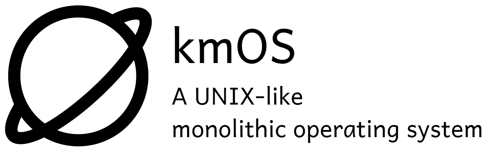
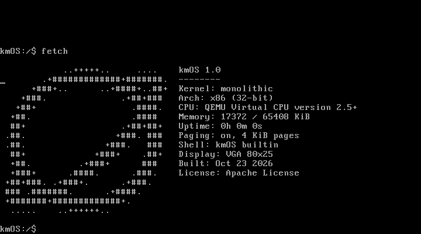
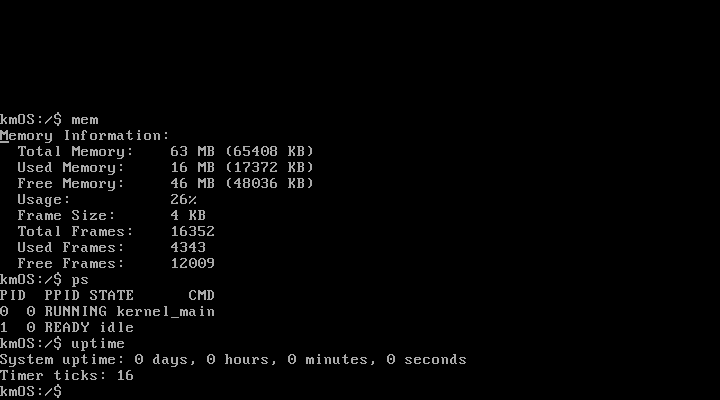
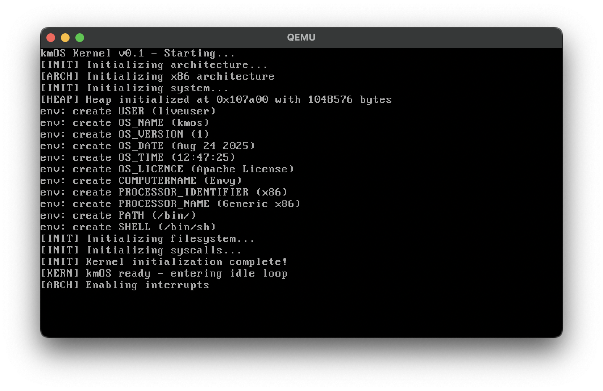
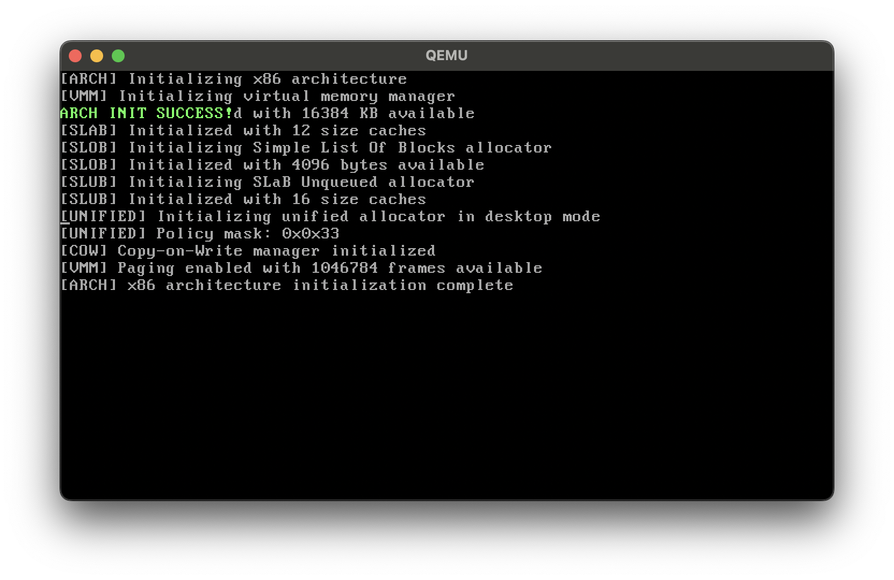

  

  
  

  

## Specifications

- UNIX-like monolithic kernel for 32-bit x86
- Kernel in C++ and assembly
- Multiboot and GRUB
- VGA and serial consoles
- Demand paging, copy-on-write and disk swap
- ELF programs, `fork`, `execve` and `waitpid`
- Userspace shell with pipes and Ctrl-C
- ext2 reads and writes

## Build and run

- `i686-elf` GCC and binutils, NASM, QEMU, make and Python 3
- `make run` (QEMU, 64 MB RAM)
- `make run USER_SHELL=1` (userspace shell)
- `make debug` (serial console in the terminal)
- `make test` (local tests, e2fsprogs for disk tests)
- `make iso` (GRUB and xorriso, or Docker/OrbStack)
- `make help` (other commands)

## Disk and swap

- `make run DISK=disk.img` (ext2 at `/mnt/disk`)
- `DISK_RW=1` (ext2 writes)
- `make swap.img` (64 MB swap image)
- `make run SWAP=swap.img` (disk swap)

## Still to do

- Signal handlers and background jobs
- SMP and more hardware drivers

## Screenshots

Earlier versions

### [v0.1](https://github.com/kkmonlee/kmOS/tree/v0.1)

### [v0.1.1](https://github.com/kkmonlee/kmOS/tree/v0.1.1)

## License

Apache License 2.0.
