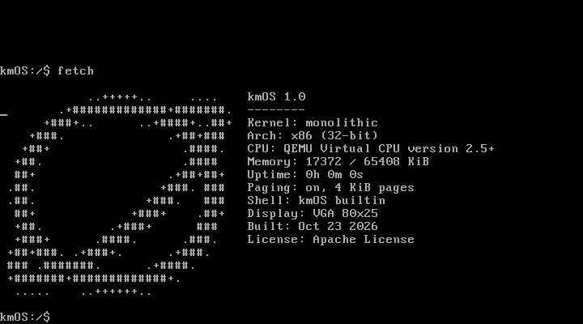
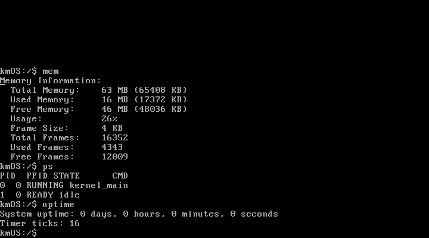
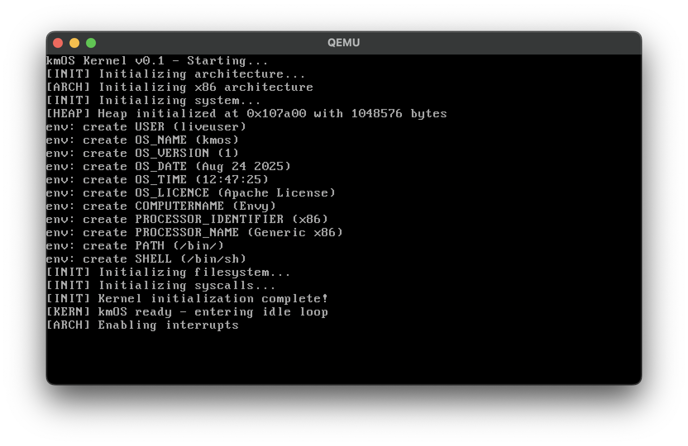
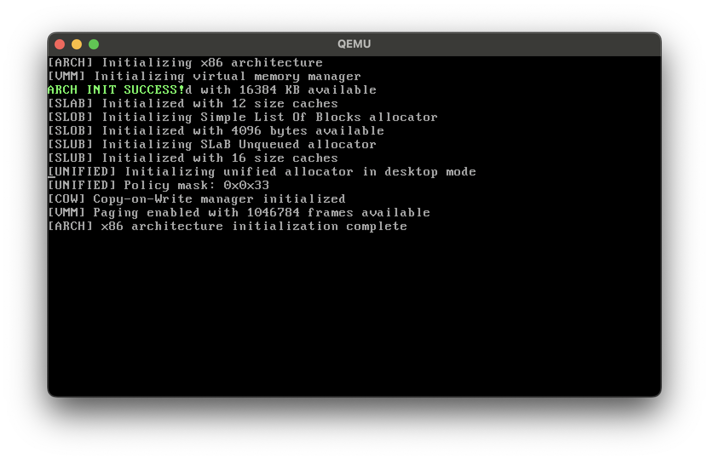

<p align="center">
  
</p>

<p align="center">
  <a href="https://github.com/kkmonlee/kmOS/actions/workflows/ci.yml"></a>
  <a href="https://github.com/kkmonlee/kmOS/actions/workflows/nightly.yml"></a>
</p>

My x86 kernel in C++. Mostly working on memory management.

Boots through Multiboot/GRUB with VGA and serial consoles.

## Running it

Needs i686-elf GCC/binutils, NASM, QEMU, make and Python 3.

```
make
make run
make debug     # terminal, Ctrl-a x to quit
make test
make test-iso  # needs GRUB + xorriso, or Docker/OrbStack
```

No disk image or root access needed. `RAM=128M make run` to change RAM.
Run `fetch` or `lsb_release -a` in the shell for system info.

Paging is on. Only the first 1 GB of RAM is managed for now.
The shell runs in kernel space. Userland and filesystems still need work.

## Screenshots

`fetch`, using the planet logo above:



Memory, processes and uptime:



<details>
<summary>Earlier boots</summary>

v0.1:



v0.1.1:



</details>

Apache License 2.0.
